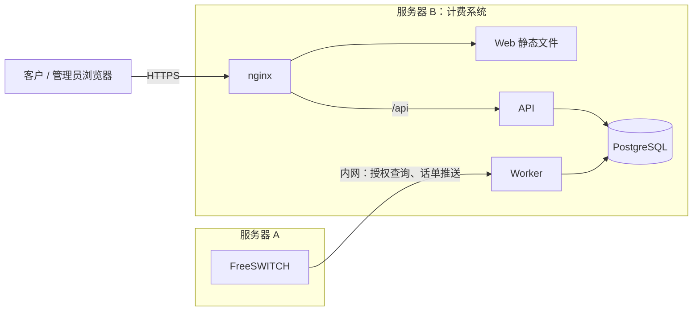

# FS-Billing

FreeSWITCH 话单计费系统。呼叫前向计费系统授权，通话结束后接收话单并扣费，维护租户余额与流水；客户通过门户自助查账，管理员通过后台开户、配置费率和处理资金。

## 系统概览

计费系统部署在独立的服务器 B，FreeSWITCH 在服务器 A，两台服务器走内网通信。网站对公网开放，被攻破也无法控制交换机；FreeSWITCH 的语音质量也不受计费系统负载影响。



| 组件       | 职责                                                          | 对外开放                  |
| ---------- | ------------------------------------------------------------- | ------------------------- |
| Web        | 客户门户和管理后台的界面，不直接访问数据库                    | 公网（HTTPS）             |
| API        | 登录、权限、数据查询与修改                                    | 公网，与 Web 同域，`/api` |
| Worker     | 面向 FreeSWITCH 的授权与话单接口，以及扣费、对账等后台任务    | 仅内网，只允许服务器 A    |
| PostgreSQL | 租户、费率、话单、账本，也是 Worker 任务队列（pg-boss）的存储 | 仅服务器 B 本机           |
| nginx      | 托管 Web 静态文件，代理 `/api`，终结 HTTPS                    | 公网                      |

FreeSWITCH 接口放在 Worker 而不是 API，网站和 API 的故障或重启不影响通话和话单采集。

### 呼叫流程

呼叫 → 授权 → 通话 → 话单推送 → 扣费 → 余额与流水 → 月账单

1. 呼叫：FreeSWITCH 按通道变量 `billing_tenant` 识别租户。
2. 授权：桥接上游之前，FreeSWITCH 请求 Worker。Worker 检查租户状态、费率匹配和可用金额（余额加透支额度），返回放行与最长通话时长，或拒绝。Worker 不可用时，合法号码按固定时长放行并标记为未经验证。
3. 通话：到达最长通话时长时 FreeSWITCH 自动挂断。
4. 话单推送：通话结束后 `mod_json_cdr` 经本机 relay 推送到 Worker；失败的话单落盘，由重推脚本补推。
5. 扣费：Worker 入库话单并创建扣费任务，按最长前缀匹配的费率计费，写入账本。
6. 余额与流水：余额由账本维护，门户和后台查看。
7. 月账单：Worker 每天 02:00（北京时间）补出缺失的已结束月份，每月 1 日自然生成上月账单，期初 + 充值 + 赠送 ± 调账 − 通话扣费 = 期末，按国家、按日汇总；每天 03:00 核对期末与流水，不一致记入系统告警。门户和后台查看，管理员可重新生成。

接口细节见 [Worker 接口](docs/worker-api.md)，FreeSWITCH 侧见 [FreeSWITCH 配置](freeswitch/README.md) 和 [FreeSWITCH 准备清单](docs/freeswitch.md)，业务规则见 [设计文档](docs/design.md) §3–§4。

## 主要功能

客户门户：

- 首页：余额、透支额度、本月消费、最近话单
- 话单：筛选、查看、导出 CSV
- 月账单：列表与详情（按国家、按日汇总），导出 CSV，打印
- 余额流水：充值、扣费、调账等记录
- 账号设置：账号信息、修改密码

管理后台：

- 租户：列表、新建、编辑，详情页含概览、余额流水、费率表、话单、账单、门户账号和设置
- 费率：按租户配置费率版本，支持导入费率表（CSV）、复制费率表到其他租户（或从其他租户复制）
- 资金：充值、赊账、调账
- 待收款：赊账充值的收款跟踪
- 账单：按月份与币种列出所有租户的月账单，重新生成（话单已删除的月份不可用）
- 管理员账号管理

尚未实现：未归属话单、余额提醒与告警邮件、系统告警与操作日志页面。进度见 [阶段计划](docs/plan.md)。

## 部署

服务器在 Debian 13 上原生部署，不用 Docker（本地开发与 CI 仍用 Docker）：

- 服务器 B：API 和 Worker 作为 systemd 服务；nginx 托管 Web 构建产物并代理 `/api`；certbot 申请并自动续期证书；PostgreSQL 用 Debian 官方包 `postgresql-17`。Worker 端口只对服务器 A 开放。
- 服务器 A：FreeSWITCH 用 SignalWire 官方 Debian 13 软件包安装，见 [FreeSWITCH 准备清单](docs/freeswitch.md) 和 [FreeSWITCH 配置](freeswitch/README.md)。

生产部署与运维手册属于[阶段计划的阶段 10](docs/plan.md#阶段-10部署与上线)，目前服务直接运行 TypeScript 源码，尚无生产打包。

## 快速开始

需要 Node.js 24.22.1（见 `.node-version`）、pnpm 10.34.7（`corepack enable`），以及 Docker（仅用于本地 PostgreSQL，执行前启动 Docker Desktop 或 OrbStack）。

首次启动按顺序执行：

```sh
corepack enable
pnpm install
cp .env.example .env
pnpm dev:setup
pnpm db:migrate
pnpm db:seed
SEED_AUTH_PASSWORD=<开发密码> pnpm --filter @fs-billing/api auth:seed
pnpm --filter @fs-billing/worker queue:migrate
pnpm dev
```

| 服务       | 地址                              |
| ---------- | --------------------------------- |
| 客户门户   | http://127.0.0.1:5173/login       |
| 管理后台   | http://127.0.0.1:5173/admin/login |
| API        | http://127.0.0.1:3000/api/health  |
| Worker     | http://127.0.0.1:3001/health      |
| PostgreSQL | 127.0.0.1:5432                    |

种子账号邮箱见 `packages/db/src/seed.ts`，密码为上面设置的 `SEED_AUTH_PASSWORD`。

| 命令            | 作用                                                          |
| --------------- | ------------------------------------------------------------- |
| `pnpm dev`      | 同时启动 Web、API 和 Worker                                   |
| `pnpm check`    | lint、格式、类型、单元测试和 Web 构建，与 CI 一致             |
| `pnpm test`     | 单元测试，不连接数据库                                        |
| `pnpm test:db`  | 数据库验收测试，需要先 `pnpm db:up`                           |
| `pnpm test:e2e` | Playwright e2e，需要已迁移、写种子的库和 `SEED_AUTH_PASSWORD` |

完整命令、视觉对照、租户隔离、金额保护规则和 CI 见 [开发指南](docs/development.md)。

## 目录

```text
apps/web         React + Vite：客户门户与管理后台
apps/api         Fastify API：登录、门户与管理后台接口、OpenAPI
apps/worker      Fastify Worker：呼叫前授权、话单入库、扣费任务与对账
packages/shared  Zod 数据格式与 API 契约
packages/db      表结构与迁移（SQL）、Drizzle 描述、账本与费率读写、种子
packages/rating  计费核心纯函数：金额、费率、计费、前缀匹配、号码归一化
freeswitch/      授权 Lua、拨号计划、mod_json_cdr、内网 relay 与落盘重推
tooling/eslint/  金额保护规则
tests/           工具与跨包测试
design/          已确认的设计稿
docs/            设计、计划、各阶段设计与验收记录、证据
```

## 文档索引

- [设计文档](docs/design.md)：业务规则与架构
- [阶段计划](docs/plan.md)：各阶段范围、验收标准与进度
- [页面说明书](docs/pages.md)：门户与后台页面
- [开发指南](docs/development.md)：命令、租户隔离、金额保护、CI、运行验证
- [Worker 接口](docs/worker-api.md)：授权、话单与扣费接口
- [FreeSWITCH 准备清单](docs/freeswitch.md) 与 [FreeSWITCH 配置](freeswitch/README.md)
- [费率表设计](docs/rate-list-design.md)
- 阶段设计与验收：[阶段 0](docs/phase-0-scaffold.md)、[阶段 1](docs/phase-1-rating.md)、[阶段 2](docs/phase-2-db.md)、[阶段 3](docs/phase-3-worker.md)、[阶段 4 后端设计](docs/phase-4-api-design.md)、[阶段 4 API](docs/phase-4-api.md)、[阶段 4 Web](docs/phase-4-web.md)、[阶段 5](docs/phase-5-design.md)、[阶段 6](docs/phase-6-design.md)、[阶段 7](docs/phase-7-design.md)
